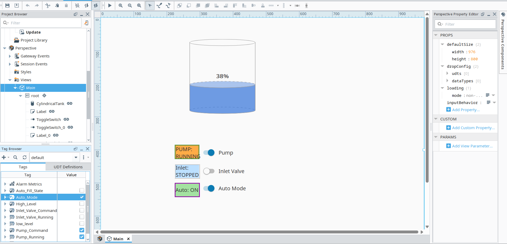

# Ignition Water Tank Control

Water tank control simulation built with Ignition Perspective
and Python/Jython scripting.

## Features
- Manual inlet valve and pump control
- Automatic filling and draining between 20% and 90%
- High level inlet protection
- Low level pump protection
- Live tank level and simulated equipment status

## Simulation approach
Memory tags represent tank level and control commands.
Expression tags provide simulated equipment status.
A Gateway timer script updates the simulated water level.
No physical PLC, sensors, or actuators are connected.

## Files

- [Ignition project export](ignition/water_tank_control.zip)
- [Tag configurations](ignition/tank_tags.json)
- [Gateway timer script](scripts/tank_level_simulation.py)

## Requirements
Ignition with the Perspective module.
The simulation script runs inside Ignition.
## Process and Electrical Schematics

The drawings show the tank process and a proposed 24 V DC
electrical circuit for the pump and inlet valve.

The current project runs as a software simulation in Ignition.
No physical PLC or field devices are connected.

## Current HMI

[View the process and electrical schematics (PDF)](docs/schematic/Water_Tank_Process_and_Electrical_Schematics.pdf)

## Video Demonstration

Watch the walkthrough covering manual operation, automatic
filling and draining, level interlocks, the HMI, and the
Python/Jython simulation script.

[Watch or download the demonstration](docs/tank-demo.mp4)
